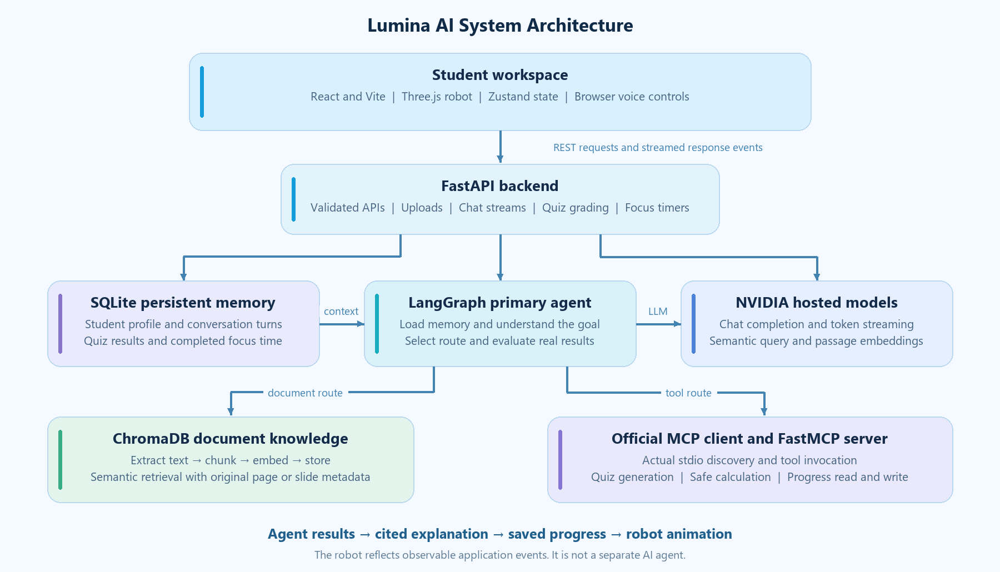
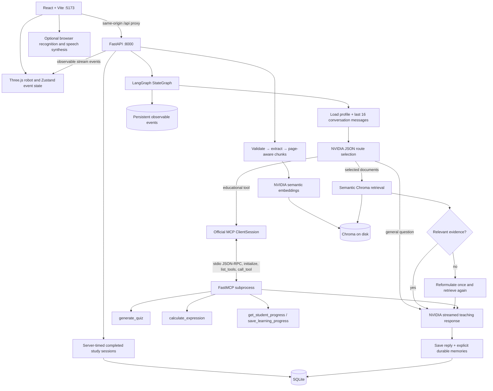

# Lumina AI — Personalized Learning Tutor

A local, single-student learning workspace for an Agent Based Modeling university project. React/Vite/TypeScript frontend, FastAPI backend, LangGraph agent, NVIDIA chat and semantic embeddings, Chroma document retrieval, SQLite memory, and a genuine stdio MCP client/server.

[GitHub repository](https://github.com/milyaskhan-2127/Lumina-AI----Personalized-Learning-Tutor) · [Word project report](docs/report/Lumina_AI_Project_Report.docx)

The report includes feature explanations, technology roles, screenshots, the architecture diagram and a demonstration sequence. Final Word pagination review remains pending; see [verification notes](VERIFICATION.md).

## Start on Windows

Requires Python 3.12+, Node.js 20.19+ (or 22.12+), and Internet access for NVIDIA calls.

1. Run `setup.cmd` once, or `powershell -NoProfile -ExecutionPolicy Bypass -File .\setup.ps1`.
2. Put the NVIDIA API key in `API.txt` in this folder. Alternatively copy `.env.example` to `.env` and set `NVIDIA_API_KEY`. The environment variable takes priority.
3. Run `start.cmd`. Keep its terminal open; Ctrl+C stops the services it started.
4. Open **http://localhost:5173**. API documentation: **http://localhost:8000/docs**.

For two visible development terminals:

```powershell
.\.venv\Scripts\python.exe -m uvicorn backend.main:app --host 127.0.0.1 --port 8000
```

```powershell
npm run dev
```

If a port is occupied, stop the earlier Lumina process first. The app deliberately uses strict ports to avoid opening an unrelated server. Localhost and 127.0.0.1 are supported. Do not expose this single-user demonstration to a public network without adding authentication, authorization, and deployment hardening.

## What works

- **Overview:** actual document counts, questions, quiz average, study streak, recent materials, and useful next actions. No fabricated statistics or seed results.
- **AI Tutor:** real token streaming, saved conversations, context-aware follow-ups, regeneration, copy, Markdown, code highlighting, KaTeX equations, source links, and selected-document controls on desktop and mobile.
- **Knowledge Library:** multiple PDF/DOCX/PPTX/TXT files; validation, extraction, chunking, NVIDIA embeddings, persistent Chroma indexing, search, text preview, original-file access, deletion, and document chat. A scanned PDF without searchable text is rejected with an OCR explanation.
- **Quiz Studio:** live MCP-generated multiple-choice or short-answer quizzes; difficulty and count controls; private answer keys; deterministic MCQ grading and LLM semantic short-answer grading; explanations; saved attempts; resume after refresh.
- **Analytics:** actual results and score chart, weighted average, topics scoring 80%+, weak-topic suggestions, and a tutor-generated revision plan.
- **Profile & Memory:** inspect, edit, and forget durable preferences. Explicit name/interest/preferences can also be extracted from chat. New conversations load the same SQLite profile.
- **Agent Insights:** observable LangGraph steps, routing, retrieval count, bounded retry, real MCP discovery/invocation, completion and failure events. No model reasoning traces are exposed.
- Responsive sky-blue glass interface, persistent dark theme, accessible labels, keyboard controls, reduced-motion support, toasts, loading and error states.
- A custom live Three.js robot (React Three Fiber and Drei) with separate head, eyes, arms, chest light and holographic book. Zustand priorities map real uploads, retrieval, MCP calls, response streaming, errors and saved quiz results to its expressions. A generated PNG is the clearly labeled 2D fallback.
- Floating companion, document-grounded Teach Me, actual document transfer progress, optional browser speech recognition and read-aloud, plus a server-validated focus timer. Only completed intervals count toward saved study time. Browser microphone permissions and voice support are required for voice features.
- Command palette (`Ctrl+K`), collapsible sidebar, profile menu, actual learning milestones, real-result confetti, cursor spotlights and spring-based card interaction.

## Architecture





| Component | Responsibility |
| --- | --- |
| `src/main.tsx`, `src/styles.css` | Seven views, reusable visual elements, API requests and SSE parsing. |
| `src/components/`, `src/premium.css` | Redesigned dashboard, shared interactions, workspace search and clickable agent workflow. |
| `src/mascot/` | Custom 3D rig, state priorities, speech, floating companion and real focus timer. |
| `backend/main.py` | Validated REST endpoints, streaming lifecycle, file handling and quiz grading. |
| `backend/agent.py` | Real LangGraph nodes, conditional routes, bounded query/tool-selection repair, answer generation, memory updates. |
| `backend/system_prompt.md` | The student's requested 12 tutoring rules, evidence policy, and injection boundaries. |
| `backend/llm.py` | NVIDIA OpenAI-compatible HTTP integration, safe errors, timeouts, bounded retries, final-content-only streaming. |
| `backend/rag.py` | File extraction, location-aware chunking, semantic embeddings, Chroma persistence and relevance filtering. |
| `backend/store.py` | SQLite profiles, conversations, quizzes, results and run events. |
| `backend/mcp_client.py` | Actual MCP initialize/discovery/tool invocation over stdio. |
| `backend/mcp_server.py` | Educational tools, LLM quiz authoring and restricted AST mathematics. |

### Three different kinds of memory

1. **Agent state:** typed LangGraph state for the current run: request, route, selected documents, retrieved excerpts, verified tool output, response. It is per-run state; observable action summaries are persisted as events.
2. **Short-term memory:** the latest 16 conversation messages, restored from SQLite for each session. This resolves phrases such as “explain it again.” Older conversation messages remain available in history but are outside the active model window.
3. **Long-term memory:** structured student preferences plus quiz history in SQLite, shared across new sessions and process restarts. Conversation memory and the Chroma knowledge database are separate stores.

### RAG behavior and source precision

Uploads are stored under generated IDs, never user-supplied paths. Chunks preserve the document ID/title and PDF page or PPTX slide. DOCX/TXT are labeled **sections**, because physical page numbers cannot be reliably extracted from these formats. Sources link to the original file; PDF links include `#page=N`.

Retrieval uses cosine similarity, a configurable relevance threshold, selected document IDs, and at most six relevant excerpts. If none pass, the graph reformulates once. If the second attempt also fails, it returns an explicit evidence-unavailable response. Answers with no selected documents are labeled general academic knowledge. These boundaries reduce hallucination; semantic correctness still needs instructor/student review.

Documents are untrusted context. Their instructions cannot override the system prompt. Generated unknown source IDs are removed before the completed answer is saved. MCP output is treated as data. Raw model reasoning is ignored.

## Configuration and data

Default live-verified model IDs:

```dotenv
NVIDIA_MODEL=nvidia/nemotron-3.5-bolt-e4b
EMBEDDING_PROVIDER=nvidia
EMBEDDING_MODEL=nvidia/nemotron-3.5-embed-1b
RETRIEVAL_MIN_SCORE=0.35
```

Model availability can change. Set replacements in `.env`, then restart. NVIDIA's hosted embedding endpoint was verified using individual passage requests; the client bounds concurrent embedding requests to three because unequal-length batches returned HTTP 500 during testing. Query and passage embedding modes follow the [official NVIDIA embedding API](https://docs.api.nvidia.com/nim/reference/nvidia-nemotron-3_5-embed-1b-infer).

Optional **local semantic embedding fallback**:

```powershell
.\.venv\Scripts\python.exe -m pip install sentence-transformers
```

```dotenv
EMBEDDING_PROVIDER=local
EMBEDDING_MODEL=sentence-transformers/all-MiniLM-L6-v2
```

The first local-model use downloads weights. Changing embedding model/provider creates a separate Chroma collection; delete/re-upload the relevant documents to index them in the new space. Local embeddings are optional and were not part of the NVIDIA verification run. The LLM remains NVIDIA-hosted.

Data lives in `backend/data/` by default: `lumina.sqlite`, `chroma/`, and `uploads/`. Set `LUMINA_DATA_DIR` for an isolated demo or test. Keep this folder for persistence. Back it up while the backend is stopped. API.txt, .env, runtime data, and logs are ignored by Git and denied by the Vite development file server. Keys are loaded only in Python and never embedded into the frontend bundle.

Files stay on the computer. **Extracted document text, selected source excerpts, messages, and relevant student preferences are sent to NVIDIA for embedding/tutoring.** Local embeddings keep embedding operations on-device, but tutor responses still use NVIDIA.

Limits: 20 MB/file, 500 PDF pages, 100 MB expanded Office archive, 2,500 chunks/document, 20 selected documents, 1–10 quiz questions. Safe math accepts arithmetic, `sqrt`, `sin`, `cos`, `log`, `abs`, `pi`, and `e`; it never uses eval or arbitrary Python execution.

## Verification

```powershell
npm run build
.\.venv\Scripts\python.exe -m pytest -q
.\.venv\Scripts\python.exe scripts/check_connection.py
.\.venv\Scripts\python.exe scripts/live_demo.py
.\.venv\Scripts\python.exe scripts/live_extras.py
.\.venv\Scripts\python.exe scripts/verify_local.py
node scripts/test-mascot.mjs
```

`requirements.lock.txt` records the installed Windows dependency versions; `package-lock.json` locks frontend dependencies. To reproduce the Python environment on Windows, use `pip install -r requirements.lock.txt`. The portable top-level constraints are in `requirements.txt`.

The live demo uses actual NVIDIA calls and credits. It starts its own hidden test backend on port 8002, generates five academic fixtures, restarts that process, and writes evidence to `output/live-<run>/verification.json`. It isolates all test profile, documents, conversations, and scores from your workspace. It stops only the process it created.

The offline tests verify restricted calculator behavior, memory and API validation, protected quiz answers, idempotent grading, and two-attempt retrieval refusal. They mock external services only for deterministic retry behavior; the live demo verifies actual services and MCP transport.

### Instructor demonstration

Generate reusable samples with `.\.venv\Scripts\python.exe scripts/make_demo_documents.py`, then:

1. Tell the tutor: “My name is [your name]. I study robotics. I prefer Roman Urdu and simple examples.” Check Profile & Memory.
2. Ask about emergence. Follow with “make it easier.” Show same-session context.
3. Upload all five files in `examples/`. Select them in chat. Ask: “In the Sable simulation, how many agents are there and what is their starting energy?” Expected evidence: **37 agents, 12 energy units, PDF page 2**.
4. Open the source chip to verify the original page. Ask a question outside the documents to demonstrate evidence handling.
5. Ask “Calculate sqrt(144) + 2**3.” Show the MCP invocation in Agent Insights and the result **20**.
6. Create a quiz, answer it, inspect explanations, and show Analytics. Ask “Use your progress tool to report my quiz history.”
7. Restart the backend, refresh the browser, create a new session, and ask for your name and field. Documents, saved conversations, preferences and results persist.
8. Edit/forget a profile field, demonstrate theme switching, and open the interface at mobile width.

### Practical boundaries

This is an Internet-connected local university application, not a multi-tenant hosted service. OCR, NVIDIA speech endpoints, public authentication and cloud synchronization are outside its implemented scope. Optional voice features use browser Web Speech APIs; speech capture may use the browser vendor's service, and the robot's speaking movement is approximate rather than amplitude-driven. Short-answer grading and automatic memory extraction are model judgments and may need correction. Persisted weak topics are recommendations based on quiz results or explicit preferences, not a clinical or standardized assessment. An available API key alone does not establish model access; use the live connection check.

## Robot demonstration

Run `python scripts/make_workflow_demo.py` with the project environment to generate `examples/06-agent-workflows.pdf`. Upload it, select it, and ask **Explain Agent Workflows**. The robot reads during actual processing, thinks during routing/retrieval and gestures while the response streams. Ask for a three-question MCQ quiz; the graph retrieves the quiz subject, invokes MCP and saves the quiz for Quiz Studio. Submit it to see real grading, feedback, robot encouragement or celebration, and persistent progress. A missed retrieval is repaired once; unsupported evidence is never replaced with invented content.

The 3D model is original geometry in `src/mascot/RobotModel.tsx`. No external GLB is used. The fallback illustration and its ImageGen prompt are documented in `public/assets/ROBOT_ARTWORK.md`. 3D is lazy-loaded, limits device pixel ratio, pauses continuous rendering offscreen or in hidden tabs, and respects reduced motion. Use the companion's **3D on** control to choose lightweight illustration mode.
